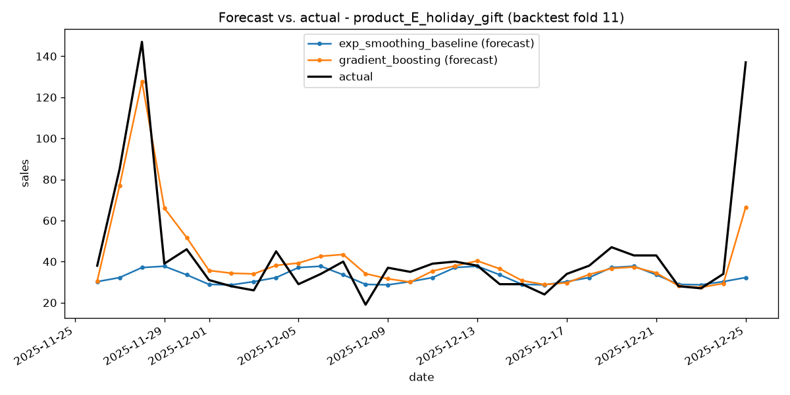
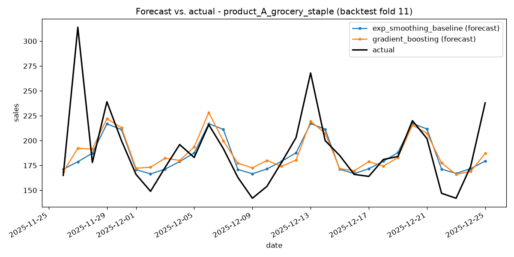

# Time Series Forecasting Service

A demand/sales forecasting system for a handful of synthetic retail products: a
deterministic synthetic-data generator, two genuinely different forecasting
approaches (classical statistical vs. gradient-boosted ML), proper walk-forward
backtesting, and a FastAPI service that forecasts with whichever model actually
backtested best for a given product.

## Motivation

Forecasting demand is one of the clearest places where it's easy to lie to
yourself with a backtest. A random train/test split, a model that's allowed to
peek at "future" lag values, or a single accuracy number averaged over every
product can all make a bad model look great. This project is built around doing
that evaluation honestly:

- **Walk-forward (rolling-origin) cross-validation only.** No random splits.
- **Recursive multi-step forecasting**, even inside the backtest - the ML
  model is never allowed to see true future values when building lag features
  for day 2, 3, ... of a forecast horizon, only its own prior predictions.
- **No cherry-picked "winner."** The two approaches are compared honestly per
  product, and the result is genuinely mixed (see [Results](#results) below) -
  the classical baseline wins on three of five products, the ML model wins on
  two. The service reflects that nuance instead of hardcoding one model.

## Architecture

```
                 (seeded, deterministic, offline)
 ┌────────────────────┐
 │  data_generation.py │  trend + weekly/yearly seasonality + holidays
 │  (scripts/          │  + shocks + noise, per synthetic product
 │   generate_data.py) │
 └──────────┬──────────┘
            │ writes
            ▼
 ┌────────────────────────┐
 │ data/synthetic_sales.csv│  (committed - reproducible, no network)
 └──────────┬──────────────┘
            │ read by
            ▼
 ┌────────────────────┐      ┌──────────────────────────┐
 │    features.py      │◄────┤ holidays.py (fixed US     │
 │ calendar + lag(1,7,  │     │ holiday calendar, shared  │
 │ 14,28) + rolling     │     │ by generator AND features)│
 │ mean(7,14,28)        │     └──────────────────────────┘
 └──────────┬──────────┘
            │ used by both
            ▼
 ┌───────────────────────────────────────────────────────────┐
 │                     backtest.py + evaluation.py             │
 │  walk-forward folds (expanding window, 30-day test blocks)  │
 │   ┌─────────────────────────┐   ┌───────────────────────┐   │
 │   │ models/baseline.py       │   │ models/ml_model.py     │   │
 │   │ Holt-Winters exponential │   │ LightGBM gradient      │   │
 │   │ smoothing (statsmodels), │   │ boosting on engineered │   │
 │   │ one fit per product      │   │ features, pooled across│   │
 │   │                          │   │ products               │   │
 │   └─────────────────────────┘   └───────────┬────────────┘   │
 │                                               │ recursive      │
 │                                               │ (forecasting.py)│
 └───────────────────────┬───────────────────────────────────────┘
                          │ writes real metrics + plots
                          ▼
          reports/backtest_metrics_*.csv, *.png
                          │ read at startup by
                          ▼
 ┌────────────────────────────────────────────────────────┐
 │                       service.py                        │
 │  per-product model selection: whichever of the two      │
 │  models actually had the lower backtest MAPE for that   │
 │  specific product is the one trained on full history    │
 │  and served live.                                       │
 └──────────────────────────┬───────────────────────────────┘
                             │
                             ▼
                   ┌───────────────────┐
                   │   api.py (FastAPI) │
                   │  POST /forecast    │
                   └───────────────────┘
```

## Setup & run

```bash
python -m venv .venv
. .venv/Scripts/activate        # Windows: .venv\Scripts\activate
pip install -r requirements.txt
pip install -e .
```

Regenerate the dataset (optional - it's already committed and deterministic):

```bash
python scripts/generate_data.py
```

Run the full walk-forward backtest and produce the report (metrics CSVs + plots
under `reports/`):

```bash
python scripts/backtest_report.py
```

Serve the API:

```bash
uvicorn time_series_forecasting_service.api:app --reload
```

## Results

Real numbers from `scripts/backtest_report.py` (12 walk-forward folds, 730-day
initial training window, 30-day non-overlapping test windows, all 5 synthetic
products, averaged across folds). **Bold** marks the lower-MAPE model per
product - that's the model the API actually serves for that product.

| Product | Model | MAE | RMSE | MAPE |
|---|---|---:|---:|---:|
| product_A_grocery_staple | **exp_smoothing_baseline** | **12.19** | **16.02** | **7.14%** |
| product_A_grocery_staple | gradient_boosting | 13.20 | 17.16 | 7.63% |
| product_B_ice_cream_seasonal | **exp_smoothing_baseline** | **13.38** | **16.83** | **16.16%** |
| product_B_ice_cream_seasonal | gradient_boosting | 14.14 | 17.72 | 17.56% |
| product_C_growth_gadget | **exp_smoothing_baseline** | **16.36** | **20.30** | **15.03%** |
| product_C_growth_gadget | gradient_boosting | 17.23 | 21.59 | 15.96% |
| product_D_declining_legacy | **exp_smoothing_baseline** | **13.18** | **16.52** | **8.54%** |
| product_D_declining_legacy | gradient_boosting | 13.79 | 17.58 | 9.04% |
| product_E_holiday_gift | exp_smoothing_baseline | 6.19 | 8.70 | 20.24% |
| product_E_holiday_gift | **gradient_boosting** | **5.69** | **7.44** | **19.42%** |

Overall average (across all products and folds):

| Model | MAE | RMSE | MAPE |
|---|---:|---:|---:|
| exp_smoothing_baseline | 12.26 | 15.67 | 13.42% |
| gradient_boosting | 12.81 | 16.30 | 13.92% |

**The classical baseline wins on raw average accuracy, but the ML model wins
specifically on the holiday-driven product.** That isn't noise - it's exactly
what the features predict: Holt-Winters' 7-day additive seasonal component
structurally cannot represent a once-a-year Black Friday/Christmas spike,
while the gradient boosting model has an explicit `is_holiday` feature that
lets it see those spikes coming. The plot below makes this visible directly:



On the calmer, trend/weekly-seasonality-dominated products, the extra
flexibility of the ML model isn't needed and its recursive multi-step forecast
accumulates slightly more error than Holt-Winters' native multi-step formula:



This is why `service.py` selects a model **per product** from
`reports/backtest_metrics_by_product.csv` rather than assuming one approach is
universally better.

## API example

```bash
curl -s -X POST http://127.0.0.1:8000/forecast \
  -H "Content-Type: application/json" \
  -d '{"product_id": "product_E_holiday_gift", "horizon_days": 7}'
```

```json
{
  "product_id": "product_E_holiday_gift",
  "model_used": "gradient_boosting",
  "generated_at": "2026-10-27T16:52:45.331971+00:00",
  "forecast": [
    {"date": "2026-01-01", "point_forecast": 34.66, "lower_bound": 11.77, "upper_bound": 57.54},
    {"date": "2026-01-02", "point_forecast": 37.35, "lower_bound": 4.98, "upper_bound": 69.72},
    {"date": "2026-01-03", "point_forecast": 38.64, "lower_bound": 0.0, "upper_bound": 78.28},
    {"date": "2026-01-04", "point_forecast": 35.88, "lower_bound": 0.0, "upper_bound": 81.66},
    {"date": "2026-01-05", "point_forecast": 30.41, "lower_bound": 0.0, "upper_bound": 81.6},
    {"date": "2026-01-06", "point_forecast": 30.86, "lower_bound": 0.0, "upper_bound": 86.93},
    {"date": "2026-01-07", "point_forecast": 30.31, "lower_bound": 0.0, "upper_bound": 90.87}
  ]
}
```

(This is a real, captured response from a local run - not hand-written.) The
prediction interval widens with `sqrt(step)` across the horizon, under an
assumption of roughly independent daily errors, using a per-product residual
standard deviation estimated on a held-out 60-day window.

Other endpoints: `GET /health` (status + which gradient boosting backend is
active) and `GET /products` (the list of known product ids). An unknown
`product_id` returns `404`; an out-of-range `horizon_days` (outside 1-90)
returns `422`.

## Testing

```bash
pytest -q
```

39 tests, covering:
- determinism and structural sanity of the synthetic data generator
- feature engineering (lag/rolling correctness, and that no feature can see
  the current or future day's actual value)
- the walk-forward split logic itself - including the one invariant the whole
  project depends on: **a fold's training window never includes a date later
  than its own test window**
- the MAE/RMSE/MAPE metric implementations against hand-computed values
- per-product model selection from a backtest report
- the `/forecast`, `/health` and `/products` endpoint contracts, including
  error cases (unknown product -> 404, invalid horizon -> 422)

`tests/test_backtest_regression.py` additionally runs a small, fast walk-forward
backtest (2 products, ~8 months) as a CI regression guard, asserting MAPE stays
under a loose sanity threshold - it exists to catch a real bug (e.g. broken lag
alignment), not to chase a specific score.

## Project structure

```
time-series-forecasting-service/
├── data/
│   └── synthetic_sales.csv            # committed, reproducible synthetic dataset
├── reports/                            # committed real backtest output
│   ├── backtest_metrics_by_product.csv
│   ├── backtest_metrics_raw.csv
│   ├── backtest_metrics_summary.csv
│   ├── forecast_vs_actual_product_A_grocery_staple.png
│   └── forecast_vs_actual_product_E_holiday_gift.png
├── scripts/
│   ├── generate_data.py                # regenerate data/synthetic_sales.csv
│   └── backtest_report.py              # run the full backtest + report
├── src/time_series_forecasting_service/
│   ├── api.py                          # FastAPI app (POST /forecast, etc.)
│   ├── backtest.py                     # walk-forward fold generation
│   ├── config.py                       # shared paths/constants
│   ├── data_generation.py              # synthetic data generator
│   ├── evaluation.py                   # runs both models across folds
│   ├── features.py                     # calendar/lag/rolling feature engineering
│   ├── forecasting.py                  # recursive multi-step ML forecasting
│   ├── holidays.py                     # fixed US holiday calendar
│   ├── metrics.py                      # MAE / RMSE / MAPE
│   ├── service.py                      # trains + serves the per-product best model
│   └── models/
│       ├── baseline.py                 # Holt-Winters exponential smoothing
│       └── ml_model.py                 # LightGBM / HistGradientBoosting wrapper
├── tests/
├── .github/workflows/ci.yml
├── pyproject.toml
├── requirements.txt
└── LICENSE
```

## Notes on dependency pinning

`lightgbm` is pinned to `<4.7` in `requirements.txt`/`pyproject.toml`: the
4.7.0 Windows wheel was found, via this project's own test suite, to crash
with a native access violation inside `LGBM_DatasetSetField` when paired with
recent `numpy` releases. 4.4-4.6 is the verified-working range on this
platform; if `lightgbm` is unavailable at all, `models/ml_model.py`
transparently falls back to scikit-learn's `HistGradientBoostingRegressor`.

## License

MIT - see [LICENSE](LICENSE).
